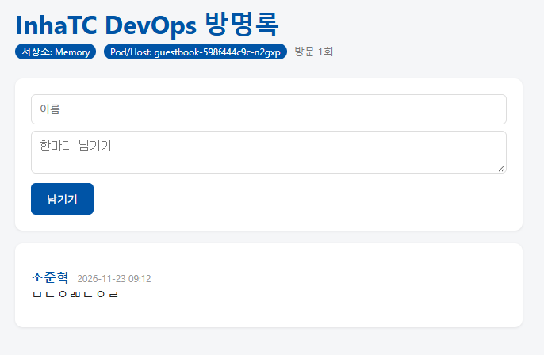

# 9주차 - 쿠버네티스

## 오늘 배운 내용

- minikube 설치 및 기동
- compose의 한계, 오케스트레이션
- 선언형, 명령형의 차이점
- kubectl 명령어
- 내 이미지 쿠버네티스에서 실행

## 실습 결과

### 방명록을 남긴 브라우저 화면

### 이해한 선언형 정리

명령형은 특정 행동을 해달라고 지시하는 것이지만, 선언형은 특정 상태를 유지해달라고 지시하는 것이라고 생각했다.
그래서 명령형으로 지시하면 구성요소에서 문제가 생겼을 때 자주 다시 지시를 해야하지만,
선언형으로 지시한다면 비교적 다시 지시를 하는 일이 줄어들 거 같다.
