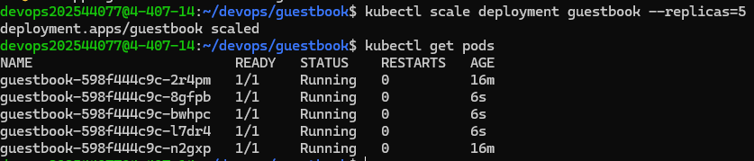

# 10주차 - 쿠버네티스 배포와 서비스

## 오늘 배운 내용

- Deployment, ReplicaSet, Pod의 계층 구조 이해
- 서비스가 필요한 이유
- 레이블과 셀렉터로 오브젝트들이 연결되는 원리 이해
- deployment.yaml, service.yaml 작성, 배포
- 스케일링, 롤링 업데이트, 롤백 실습

## 실습 결과

### replicas 5로 늘리기



### 롤링 업데이트 후 결과
```
$ kubectl rollout history deployment/guestbook
deployment.apps/guestbook
REVISION  CHANGE-CAUSE
2         v3: 제목 변경
3         v1: 롤백 완료
```
